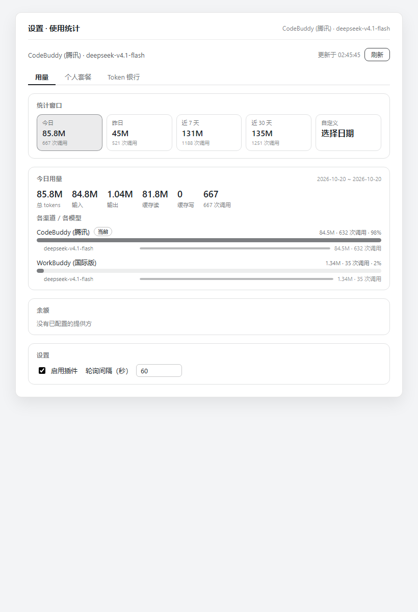
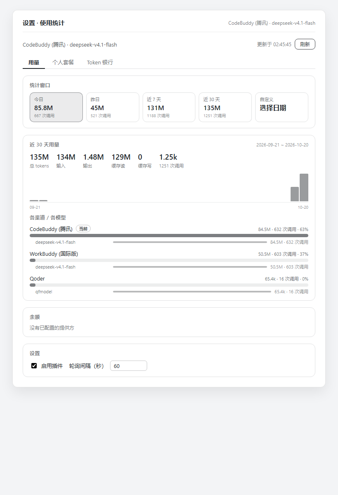
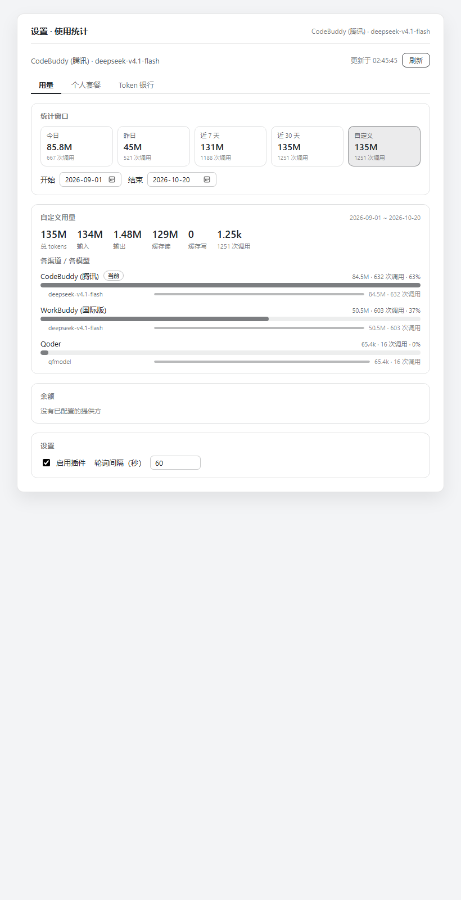

# @linxin666/dsh-usage

DSH Web GUI 的用量统计插件:按 provider 记录 token 账本、探测余额与编码套餐额度,并在侧栏 Settings 上方放一张紧凑的价格速览卡。
Usage statistics plugin for the DSH web GUI: per-provider balance and coding-plan quota detection plus a live token usage ledger, with a compact price glance card above the sidebar's Settings row.

> 双语说明:每一节先中文、后英文,两种语言都能独立读完。
> Bilingual on purpose: each section gives the Chinese text first, then the English text; either half reads on its own.



---

## 简介 · Overview

### 中文

`dsh-usage` 是 DeepSeek Harness(DSH)的用量统计插件。本仓库包含它的源码、构建产物与测试脚本,并在上游@linxin666/dsh-usage 0.4.8 之上做了四类增强:

1. **使用统计面板重做**(浏览器半边 `lib/client.js`)——8 个统计窗口、6 格汇总、趋势图、按渠道/按模型的彩色拆分,详见下文「特性」。
2. **会话日志回填**(host 半边 `lib/index.js`)——插件挂载之前发生的用量,从会话日志补读回来;由 `src/` 直接构建。
3. **多设备账本**——每台机器写自己的 `usage-ledger.<device>.json`,总览相加所有设备;账本可导出/导入,导入是替换而非合并,同一文件导入两次不会重复计数。详见 [`docs/multi-device.md`](docs/multi-device.md)。
4. **上游 0.4.8 合并**——DeepSeek 峰谷价标签;识别反向代理的 loopback 校验(`isProxiedRequest()`):带 `x-forwarded-for` 或 `cf-connecting-ip` 的请求不再被当作本机直连,堵住 GUI 挂在反代后面的鉴权绕过。

基线是 npm 上正式发布的 **0.4.8**(本地合并,不是上游 fork)。

### English

`dsh-usage` is the usage-statistics plugin for DeepSeek Harness (DSH). This repository holds its sources, build output and test harnesses, plus four groups of enhancements on top of upstream 0.4.8:

1. **A redesigned usage panel** (browser half, `lib/client.js`) — eight statistic windows, a six-cell totals row, a trend chart and a colour-coded channel/model breakdown; see Features below.
2. **Session-log backfill** (host half, `lib/index.js`) — usage that happened before the plugin mounted is read back from the session logs; built straight from `src/`.
3. **Multi-device ledgers** — each machine writes its own `usage-ledger.<device>.json` and the overview sums every device; ledgers can be exported and imported, and importing replaces (never merges), so the same file cannot double-count. See [`docs/multi-device.md`](docs/multi-device.md).
4. **Upstream 0.4.8 merge** — the DeepSeek peak/off-peak badge, and a proxy-aware loopback guard (`isProxiedRequest()`): requests carrying `x-forwarded-for` or `cf-connecting-ip` no longer count as loopback, which closes an auth bypass when the GUI sits behind a reverse proxy.

The baseline is the published npm release **0.4.8** (merged locally; not a fork of the upstream repo).

---

## 特性 · Features

### 中文

以下是面板这边的核心特性。

**8 个统计窗口。** 今日、昨日、近 3 天、近 7 天、近 30 天、近 6 个月、全部、自定义。45 天以内按天累加;更长的窗口(近 6 个月、全部、超 45 天的自定义)由一次 `GET /api/dsh-usage/range` 聚合查询给出,半年视图不必再逐天抓两百次。

**6 格汇总,回答「缓存到底值不值」。** 总 tokens、输入、输出、缓存读、缓存命中率、调用次数。命中率 = `cacheRead / (input + cacheRead + cacheWrite)`——判断 prompt 缓存是否划算,看的就是这个数。

**长窗口友好的趋势图。** `TrendChart` 分桶:≤45 天按天、46–200 天按周、更长按月;网格线取 1/2/5×10ⁿ;悬浮提示给出总量、调用次数、命中率与前三名模型;没有记录的日子明确标注「无记录」。

**一个模型一种颜色,到处一致。** 颜色由归一化模型名的稳定哈希在 16 色色板上取位得到,同一个模型在趋势图、渠道条、模型子条、图例和悬浮提示里都是同一种颜色;只差大小写或 `provider/` 前缀的写法(`DeepSeek-V4.1-Flash` 与 `deepseek-v4.1-flash`)会归一成同一个模型,而不是拆成两种颜色。

**拆分列出每一个模型,不只是前三名。** 每个渠道先画一条按模型堆叠的条,再逐行列出 host 返回的每一个模型(协议单渠道上限 12 行),每行一条同色子条。渠道条以**窗口总量**为分母,长度就是渠道在窗口里的占比;模型子条以**自己的渠道**为分母,读起来就是「这个渠道怎么分」。渠道行用更重的字重,模型行整体压暗一档,两个层级一眼能分开。

**从侧栏一步到面板。** 点侧栏底部的用量卡,直接打开「设置 · 使用统计」,不用再走账号菜单。实现是请 shell 的 registry 打开设置页(合成一次 Ctrl+, 按键,这是平台的默认快捷键);500 ms 内面板没出现,才退回账号菜单那条路。

### English

The panel-side features at a glance:

**Eight statistic windows.** Today, Yesterday, Last 3 days, Last 7 days, Last 30 days, Last 6 months, All time, Custom (the UI shows these labels in Chinese). Windows up to 45 days are summed day by day; anything longer — all time, or a custom range past 45 days — is answered by one `GET /api/dsh-usage/range` aggregate, so a six-month view no longer has to fetch two hundred days one at a time.

**A six-cell totals row that answers the cache question.** Total tokens, input, output, cache read, cache-hit ratio and calls, where the ratio is `cacheRead / (input + cacheRead + cacheWrite)` — the number to look at when judging whether prompt caching pays for itself.

**A trend chart that survives long windows.** `TrendChart` buckets daily up to 45 days, weekly from 46 to 200, monthly beyond that; gridlines follow the 1/2/5×10ⁿ steps; the hover tooltip shows totals, calls, the hit ratio and the top three models; days with nothing recorded say so explicitly.

**One colour per model, everywhere.** Colours come from a stable hash of the normalized model name over a sixteen-hue palette, so a model keeps a single hue across the trend chart, the channel bars, the model rows, the legend and the tooltip. Spellings that differ only by letter case or by a `provider/` prefix (`DeepSeek-V4.1-Flash` vs `deepseek-v4.1-flash`) fold into one model instead of splitting into two colours.

**A breakdown that lists every model, not just the top three.** Each channel draws one bar stacked by its models, then lists every model the host returned (the wire caps a provider at twelve rows) with a sub-bar in the same hue. The channel bar measures against the window total, so its length is the channel's share of the window; the model sub-bars measure against their own channel, so they read as how that channel splits. The channel header carries the heavier type and the sub-rows sit one step lighter, which keeps the two levels apart at a glance.

**One click from the sidebar to the panel.** Clicking the usage card at the bottom of the sidebar opens the usage-statistics settings page directly instead of going through the account menu. It asks the shell's registry to open the page (a synthetic Ctrl+, keydown, the platform default) and falls back to the account-menu path only if the page has not appeared within 500 ms.

---

## 快速开始 · Quick start

### 中文

环境要求:Node `^22.19.0` 或 `>=24.0.0`,DSH `>=0.2.1-rc.2`,React `^18.2.0`(peer)。许可证 Apache-2.0。

```bash
pnpm install --frozen-lockfile                     # 从 pnpm-lock.yaml 装工具链
cd packages/dsh-usage && ../../node_modules/.bin/tsc -b tsconfig.build.json \
  && ../../node_modules/.bin/tsdown                # 构建(~100 ms,exit 0)
cd ../.. && node harness/build-test-bundle.cjs && node harness/render-test.mjs
node --experimental-strip-types harness/host-test.mjs
```

期望输出:`=== 225/225 checks passed ===` 和 `=== 262/262 checks passed ===`。`node_modules/` 已被 git 忽略,新克隆的仓库要先装依赖;构建能逐字节复现已提交的产物。

### English

Requirements: Node `^22.19.0` or `>=24.0.0`, DSH `>=0.2.1-rc.2`, React `^18.2.0` (peer). Licensed under Apache-2.0.

```bash
pnpm install --frozen-lockfile                     # toolchain from pnpm-lock.yaml
cd packages/dsh-usage && ../../node_modules/.bin/tsc -b tsconfig.build.json \
  && ../../node_modules/.bin/tsdown                # build (~100 ms, exit 0)
cd ../.. && node harness/build-test-bundle.cjs && node harness/render-test.mjs
node --experimental-strip-types harness/host-test.mjs
```

Expected: `=== 225/225 checks passed ===` and `=== 262/262 checks passed ===`. `node_modules/` is git-ignored, so a fresh clone must run the install first; the build reproduces the committed artifacts byte-for-byte.

---

## 安装到其他机器 · Install on another machine

### 中文

两步:把包装进 profile,再登记进 `dsh.profile.bundles`。

**第 1 步 · 安装。** profile 通常把这个包钉在 registry 版本上,而 profile 里任何其他插件的安装、升级或卸载都会重新解析这个 pin,把这份拷贝**覆盖掉**。改指向 git 依赖后,commit 被钉住,拷贝就稳定了:

```bash
cd "${DSH_HOME:-$HOME/.dsh}/profiles/desktop"
pnpm remove @linxin666/dsh-usage
pnpm add "github:beici/dsh-usage-for-personal-use#path:/packages/dsh-usage"
```

**第 2 步 · 登记 bundle。** host 只从 `dsh.profile.bundles` 列表构建补丁层,不是从 `node_modules`——装了但没登记的包等于不存在:没有补丁层、没有路由、没有面板:

```js
// DSH host 里的 loadProfileDirectory()
const bundles = readProfileManifest(binName, dir).dsh?.profile?.bundles ?? [];
for (const packageName of bundles) { /* resolve, read dsh.bundle.patch, load */ }
```

插件管理器和插件市场两条路会自动登记;手工 `pnpm add` 只做了第 1 步,所以要补上:

```bash
node -e '
  const fs = require("fs");
  const p = "package.json";
  const m = JSON.parse(fs.readFileSync(p, "utf8"));
  m.dsh ??= {}; m.dsh.profile ??= {};
  const b = m.dsh.profile.bundles ??= [];
  if (!b.includes("@linxin666/dsh-usage")) {
    b.push("@linxin666/dsh-usage");
    fs.writeFileSync(p, JSON.stringify(m, null, 2) + "\n");
    console.log("added to dsh.profile.bundles");
  } else console.log("already in dsh.profile.bundles");
'
```

然后**重启 DSH**:host bundle 在启动时一次性进 ESM 图,新的 host 路由必须重启(只改客户端半边的话,刷新页面即可)。

**踩坑清单:**

- `#path:/packages/dsh-usage` 必填——插件在仓库的子目录里,不在根目录。
- 离线机器可改用本地克隆:`git+file:///E:/path/to/dsh-usage/.git#path:/packages/dsh-usage`;目录本身不是 git checkout 时用 `file:E:/path/to/dsh-usage/packages/dsh-usage`。POSIX 风格路径的 `file:` 会报 `ERR_PNPM_LINKED_PKG_DIR_NOT_FOUND`,Windows 上要传 Windows 路径(`cygpath -w`)。
- pnpm 会把 git 依赖解析成钉住 commit 的 codeload tarball(`pnpm-lock.yaml` 里形如 `…/tar.gz/<sha>#path:/packages/dsh-usage`),装出来是一份**真拷贝,不是链接**:好处是别的插件再也覆盖不掉,坏处是**新提交不会自己过来**——推完之后重跑一次 `pnpm add`(或 `pnpm update @linxin666/dsh-usage`)。
- `hoisted` linker 下改 `src/` 不会更新已安装的机器:重新构建、提交、再跑一次 `pnpm add`。
- 命令以 `ERR_PNPM_IGNORED_BUILDS`(koffi、node-pty、protobufjs……)收尾是 profile 既有的噪声,不是失败。装好后用 `patches/audit-store.sh` 加下面的哈希表验证;树已经来自本仓库,`patches/install-patches.sh` 不再需要。

### English

Two steps: install the package into the profile, then register it in `dsh.profile.bundles`.

**Step 1 — install.** Profiles normally pin this package to a registry version, and any other plugin's install, update or removal re-resolves that pin and **overwrites the copy**. Pointing the profile at a git dependency pins the commit instead and makes the copy stable:

```bash
cd "${DSH_HOME:-$HOME/.dsh}/profiles/desktop"
pnpm remove @linxin666/dsh-usage
pnpm add "github:beici/dsh-usage-for-personal-use#path:/packages/dsh-usage"
```

**Step 2 — register the bundle.** The host builds its patch layers from the `dsh.profile.bundles` list, not from `node_modules` — a package that is installed but absent from the list is simply never loaded: no patch layer, no routes, no panel:

```js
// loadProfileDirectory() in the DSH host
const bundles = readProfileManifest(binName, dir).dsh?.profile?.bundles ?? [];
for (const packageName of bundles) { /* resolve, read dsh.bundle.patch, load */ }
```

The plugin manager and the plugin market register the bundle for you; a bare `pnpm add` does not, so add it by hand:

```bash
node -e '
  const fs = require("fs");
  const p = "package.json";
  const m = JSON.parse(fs.readFileSync(p, "utf8"));
  m.dsh ??= {}; m.dsh.profile ??= {};
  const b = m.dsh.profile.bundles ??= [];
  if (!b.includes("@linxin666/dsh-usage")) {
    b.push("@linxin666/dsh-usage");
    fs.writeFileSync(p, JSON.stringify(m, null, 2) + "\n");
    console.log("added to dsh.profile.bundles");
  } else console.log("already in dsh.profile.bundles");
'
```

Then **restart DSH**: the host bundle joins the ESM graph once at boot, so new host routes need a restart (client-only changes reload on page refresh).

**Pitfalls:**

- `#path:/packages/dsh-usage` is required — the plugin lives in a subdirectory of the repository, not at its root.
- On a machine without network access to the remote, use a local clone: `git+file:///E:/path/to/dsh-usage/.git#path:/packages/dsh-usage`; for a plain directory that is not a git checkout, `file:E:/path/to/dsh-usage/packages/dsh-usage`. A POSIX-style path with `file:` fails (`ERR_PNPM_LINKED_PKG_DIR_NOT_FOUND`) — pass a Windows path (`cygpath -w`) on Windows.
- pnpm resolves the git dependency to a commit-pinned codeload tarball (`…/tar.gz/<sha>#path:/packages/dsh-usage` in `pnpm-lock.yaml`), so the installed tree is a **real copy, not a link**: other plugins can no longer overwrite it, but **new commits do not arrive by themselves** — re-run `pnpm add` (or `pnpm update @linxin666/dsh-usage`) after pushing.
- Under the `hoisted` linker, editing `src/` does not update an installed machine: rebuild, commit, run `pnpm add` again.
- Ending with `ERR_PNPM_IGNORED_BUILDS` (koffi, node-pty, protobufjs, ...) is pre-existing profile noise, not a failure. Verify with `patches/audit-store.sh` plus the hash table below; the tree already comes from this repo, so `patches/install-patches.sh` is no longer needed.

---

## 产物哈希 · Current artifact hashes

### 中文

本仓库当前构建产物(2026-10-27 核对):

| 文件 | 大小 | MD5 |
| --- | --- | --- |
| `lib/client.js` | 528,487 B | `7f953820bc4bcb499fb0e2c0274d302b` |
| `lib/client.js.map` | 709,158 B | `f89f3374637620f938f16d92084ca00a` |
| `lib/index.js` | 179,284 B | `bb1518048d95a3e3a97d12974d6656b9` |

`lib/client.js.map` 会把源码原样嵌进去,只有源码用 LF 换行时才能逐字节复现(`.gitattributes` 在 checkout 时强制 `eol=lf`);工作区留 CRLF 源码时 map 会变大、哈希对不上,而 `client.js` 本身不变。两边都从 `src/` 构建,`lib/index.js` 和已安装副本是同一个产物。部署就是一次普通拷贝,但有两个坑:在 profile 里跑 `pnpm install` 会把包重置回 registry tarball;`cp` 到 pnpm 硬链接上会穿透写入 content-addressed store。详见 [`docs/build-and-redeploy.md`](docs/build-and-redeploy.md)。

### English

Artifacts built from this repository (verified 2026-10-27):

| File | Size | MD5 |
| --- | --- | --- |
| `lib/client.js` | 528,487 B | `7f953820bc4bcb499fb0e2c0274d302b` |
| `lib/client.js.map` | 709,158 B | `f89f3374637620f938f16d92084ca00a` |
| `lib/index.js` | 179,284 B | `bb1518048d95a3e3a97d12974d6656b9` |

`lib/client.js.map` embeds the sources verbatim and is only reproducible when the sources use LF endings (`.gitattributes` enforces `eol=lf` in the checkout); a worktree left with CRLF sources produces a larger, differently hashed map while `client.js` itself stays identical. Both halves build from `src/`, so `lib/index.js` and the installed copy are the same artifact. Deploying is a plain copy, with two hazards: a `pnpm install` in the profile resets the package to the registry tarball, and `cp` onto a pnpm hardlink writes through to the content-addressed store. See [`docs/build-and-redeploy.md`](docs/build-and-redeploy.md).

---

## 目录 · Layout

### 中文

| 路径 | 说明 |
| --- | --- |
| `packages/dsh-usage/` | 插件包本体:`src/`(权威 TS 源码)、`lib/`(构建产物)、`package.json`、`tsconfig*.json`、`tsdown.config.ts`,以及打包资产(`cordis.patch.yml`、`icon.svg`、README、`LICENSE`)。 |
| `shared/tsdown.client.ts` | 客户端打包预设(`clientBundle()` / `clientConfig()`,来自上游 monorepo),`packages/dsh-usage/tsdown.config.ts` 依赖它。 |
| `shared/web-platform.ts` | `PLATFORM_MODULES`:浏览器包允许向 shell 外部引用的模块清单。 |
| `harness/render-test.mjs` | jsdom 渲染测试:用保存的线上 fixture 挂载构建产物,断言 225 条事实,覆盖 8 个窗口、汇总行、趋势图、渠道拆分、设备同步卡、DeepSeek 峰谷标签,失败窗口不出总数、失败日期在趋势图上以斜纹标注、失败聚合不画笃定柱、重试有上限且不丢已结算值、模型行百分比凑满 100%、模型色相跨窗口不变、页签键盘导航、自定义窗口不许越过今天、失败聚合在图内说明而不是画一排笃定柱、重试预算只在账本历史变化时恢复、模型色板在白色与最亮的深色底上都够对比度、轮询间隔输入框只在失焦或回车时提交、模型色阶与模型到达顺序无关、缺一天的窗口不给总数、调用数格自带单位、设备同步把导出失败和导入失败分开说、侧栏卡片不再把数字藏进 aria-label、重绘成功会清掉票券错误、空转的 snapshot 不会重置重试链、部分加载的窗口在趋势图 aria 里不冒充合计、导出按钮在生成图片期间改文案并禁用、窗口条在窄面板下换成两列、导入本机自己的导出用面板自己的话说、计划用量条在预警与危险区间仍保留填充高度、重试阶梯逐级拉长并在上限处停下、部分加载的窗口不宣称渠道份额、范围窗口重取失败时保留原有数字、全部窗口回看到合并账本的起点、计划与设备故障都用读者的语言表述、票券保存抛错不会卡住按钮、被截断的窗口标签在 title 里保留全文、窗口条按卡片自身宽度换列、只有一天的窗口说明无法画趋势、失效的词典键已删除、range 结果缓存有上限、票券空图报保存失败、rescan 不覆盖更新的轮询、诊断原文对读屏可达、两张卡片不共用控件 id、日期选择器的标签指向自己的下拉框、趋势图对外是一个组、隐藏页签不绘制、计划分条百分比与标签一致、复制按钮说明它复制什么、趋势条不占 tab 停靠点、挂起的设备操作会超时并交还按钮、复制失败会说明、银行日失败原文对读屏可达、单日窗口只印一次日期、被拒绝的设置写回退到已存值、账本历史移动时旧窗口的合计先让位再回来、单日票券只印一次日期、剪贴板同步抛错也会交还按钮并说明失败、本机绘制失败与请求失败分开说、自定义区间反向输入时各归各位、历史戳同时覆盖 tokens 与调用数和成本(改价或换日不再沿用旧拆分)、聚合结果绑定自己的日期跨度(换窗口不再沿用上一个窗口的合计)。 |
| `harness/host-test.mjs` | host 侧测试(262 条),用 Node 类型剥离直接跑 `src/`:设备 id、导出/导入、账本相加、旧版迁移、会话日志回填(含跨文件去重与一次性回退修复)、实时 fold、range 聚合、账本隔离与双进程合并、修复幂等与地板、固定机器 id(改名后仍是同一台机器)、无 machine 的同伴文件不计入、保留期区分时钟跳变与用户调小、提示按类去重、账本隔离后的旧历史恢复、loopback 校验、峰谷时钟、写盘失败不把膨胀桶灌回、派生摘要的文件视为本机、pin 丢失后旧文件仍算本机、调小保留期重启后生效、调小保留期不能清空账本、拒绝提示在裁剪落地后退休、迁移两半不重复计、导入保留 peer 的窗口、lock-busy 只由持锁的写退休、修不完的桶会说出来、无 machine 的同伴只丢共享桶、隔离副本保留最新的、带 BOM 的导出可导入、调小窗口不再甩锅给时钟、可选日期覆盖被计入的每一天、加载重试不丢实时调用、别人的锁不去抢、带 BOM 的账本照常读取、隔离时保留被点名的那一份、修好的桶不再被误判为膨胀、无 machine 的同伴按差量计入、拿不到锁的导入不写盘、没有地板的修复记录不再二次扣除、带 BOM 的修复记录仍守住它的桶、两个文件指向同一台机器时只算一次、带 BOM 的迁移前账本会被收养、隔离副本按写入时刻保留最新的、导出带上它被裁剪到的窗口、两份副本在内存和文件里都会被扣掉、无 machine 同伴的零调用残差不计成 token、窗口外但账本仍保留的日子照样被修好、调小保留期不再甩锅给时钟、一次剪掉多天会说出来。 |
| `harness/build-test-bundle.cjs` | 从构建好的 `lib/client.js` 派生 `harness/client.test.cjs`,只多插一行测试需要的导出。 |
| `harness/make-panel-html.cjs` | 生成 `harness/panel.html`,自包含页面,用于无头截图。 |
| `fixtures/` | 2026-10-20 抓取的线上 `/api/dsh-usage` 响应(总览 + 4 天记录)。 |
| `patches/` | 早期回填补丁、应用脚本与改动前的产物包,用于回滚。 |
| `preview/` | 重做后的截图。 |
| `reference/upstream-0.4.8/` | 原封不动的 0.4.8 `src/` + `package.json`,用于对比升级。 |
| `docs/` | 文档(见下)。 |

### English

| Path | What it is |
| --- | --- |
| `packages/dsh-usage/` | The plugin package: `src/` (authoritative TS source), `lib/` (build output), `package.json`, `tsconfig*.json`, `tsdown.config.ts`, packaging assets (`cordis.patch.yml`, `icon.svg`, READMEs, `LICENSE`). |
| `shared/tsdown.client.ts` | The client-bundle preset (`clientBundle()` / `clientConfig()` from the upstream monorepo) — required by `packages/dsh-usage/tsdown.config.ts`. |
| `shared/web-platform.ts` | `PLATFORM_MODULES`: the externals the browser bundle may require from the shell. |
| `harness/render-test.mjs` | jsdom render test: mounts the built bundle with saved live fixtures and asserts 225 facts about the eight windows, the totals row, the trend chart, the channel breakdown, the device-sync card and the DeepSeek peak badge — plus a failed window stating no total, a failed aggregate drawing no confident bars, a retry loop that backs off and gives up, model rows adding up to 100 %, a keyboard-navigable tablist and a custom window refusing to run past today, a failed aggregate stated in the plot instead of drawn as a wall of bars, a retry budget that refills only when the ledger history moves, a model palette measured to clear 3:1 on white and on the lightest plausible dark surface, a poll-interval field that commits only on blur or Enter, a model shade that does not depend on arrival order, a window missing a day stating no total, a calls cell that names its unit, export failures told apart from import failures, a sidebar card that no longer hides its figures behind an aria-label, a successful redraw clearing the voucher error, a retry chain a no-op snapshot does not rewind, a partly loaded window not claiming a total in the chart label, an export button that renames itself while it renders, a range strip that folds to two columns on a narrow panel, a self-import said in the panel own words, a plan bar that keeps its fill geometry in the warn and low bands, a retry ladder that walks growing rungs and stops at its cap, a partly loaded window not claiming channel shares, a failed range refetch keeping its numbers, the 全部 window reaching back to the merged ledger, plan and device failures stated in the reader own language, a throwing voucher save that cannot wedge the button, a truncated tile label keeping its full text in the title, a range strip folded by the card own width, a one-day window saying it has too few days for a trend, and the dead dictionary entries gone, a range result cache that is capped, a null voucher image reported as a save failure, a rescan that cannot overwrite a newer poll, a diagnosis reachable to a screen reader, two cards not sharing a control id, a day picker whose label points at its own select, a trend chart exposed as one group, a hidden tab that does not paint, a plan sub-bar whose share matches its label, a copy button that says what it copies, bars that are not tab stops, a hung device action that times out and hands the buttons back, a failed copy that speaks, a bank day failure reachable to a screen reader, a single day printed once, and a rejected settings write that restores the stored value, a range total that steps aside while its history moves and comes back grown, a single-day voucher that states its date once, a clipboard that throws synchronously still releasing the button and saying the copy failed, a local draw failure told apart from a request failure, and an inverted custom pair keeping each typed value in its own box, a history stamp that also covers calls and cost, and an aggregate tied to the span it was fetched for. |
| `harness/host-test.mjs` | Host-side tests (262 checks), run straight off `src/` with Node type stripping: device ids, export/import, ledger summing, legacy migration, transcript backfill (cross-file dedupe and the one-time repair), the live fold, the range aggregate, ledger quarantine and two-process merging, repair idempotence and its floors, field-wise merges, repaired-at adoption, a pinned machine id that survives a host rename, peer documents without one being refused, a retention guard that tells a clock jump from a lowered retention, a note registry that does not grow per poll, legacy history restored after a quarantine, a failed write not resurrecting the inflated buckets, a digest-stamped file counting as this machine, a file under a lost pin still folding in, a lowered retention taking effect after a restart, the loopback fence, the peak clock, a repair written under the same lock as a flush, an unreadable ledger moved aside after the retry budget, the durable machine-alias record, an unverified peer contributing only days this machine never recorded, a retention note that survives the first flush, a quarantined ledger still folding the old history back in, a lowered window that cannot delete the history, a foreign lock left alone, a day picker listing only days this machine recorded, a re-import merging day by day instead of replacing the file, a refused clock jump keeping its window across a restart, a second migration keeping the days the first one retired, an import keeping the machine id the peer file already had, quarantine copies capped at three, and a refresh during the load not double counting a peer, a shrink that cannot empty the ledger, a refusal note retired once a prune lands, migration halves not counted twice, an import keeping the window the peer recorded, a lock-busy note retired only by the write that holds the lock, a repair that cannot finish saying so, an unverified peer losing only the buckets it shares, quarantine copies keeping the newest, a BOM-prefixed export importing, a shrink not blamed on the clock, available days covering every day the totals count, a load retry not discarding live calls, a stale lock left alone, a BOM-prefixed ledger still reading, the quarantine keeping the copy it names, a repaired bucket no longer read as inflated, an unverified peer counted as a per-bucket difference, and an import that stands down when the lock is held elsewhere, a repair record without floors subtracting nothing, a BOM-prefixed repair record still guarding its buckets, one machine under two file names counting once, a BOM-prefixed pre-migration ledger adopted, quarantine copies kept by write instant, an export carrying the window it pruned to, and two copies taken out in memory and in the file, an unverified peer's token-only residue not counted, a day the ledger keeps still repaired outside the window, a shrink no longer blamed on the clock, and a slab prune saying so. |
| `harness/build-test-bundle.cjs` | Derives `harness/client.test.cjs` from the built `lib/client.js` by adding one export line the test needs. |
| `harness/make-panel-html.cjs` | Builds `harness/panel.html`, a self-contained page for headless screenshots. |
| `fixtures/` | Live `/api/dsh-usage` responses captured 2026-10-20 (overview + 4 recorded days). |
| `patches/` | The legacy backfill patch, its appliers, and the pre-change bundles for rollback. |
| `preview/` | Screenshots of the redesigned panel. |
| `reference/upstream-0.4.8/` | Pristine published 0.4.8 `src/` + `package.json`, for upgrade diffs. |
| `docs/` | Documentation (below). |

---

## 文档 · Documentation

### 中文

- [`docs/usage-panel-redesign.md`](docs/usage-panel-redesign.md) —— 新面板的设计。
- [`docs/build-and-redeploy.md`](docs/build-and-redeploy.md) —— 部署、重载行为与回滚。
- [`docs/multi-device.md`](docs/multi-device.md) —— 设备文件、导出/导入与合并。
- [`docs/upstream-and-local-patches.md`](docs/upstream-and-local-patches.md) —— 上游基线与补丁清单。

### English

- [`docs/usage-panel-redesign.md`](docs/usage-panel-redesign.md) — design of the redesigned panel.
- [`docs/build-and-redeploy.md`](docs/build-and-redeploy.md) — deployment, reload behaviour and rollback.
- [`docs/multi-device.md`](docs/multi-device.md) — device files, export/import and merging.
- [`docs/upstream-and-local-patches.md`](docs/upstream-and-local-patches.md) — upstream baseline and patch inventory.

---

## 截图 · Screenshots

### 中文

近 30 天与自定义区间视图(完整页面见 `preview/panel.html`):

### English

The last-30-days and custom-range views (full page in `preview/panel.html`):




---

## 许可证 · License

Apache-2.0。见 [`packages/dsh-usage/LICENSE`](packages/dsh-usage/LICENSE)。
Licensed under the Apache License 2.0 — see [`packages/dsh-usage/LICENSE`](packages/dsh-usage/LICENSE).
